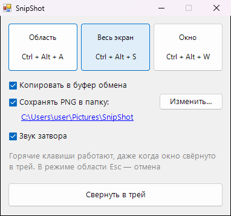
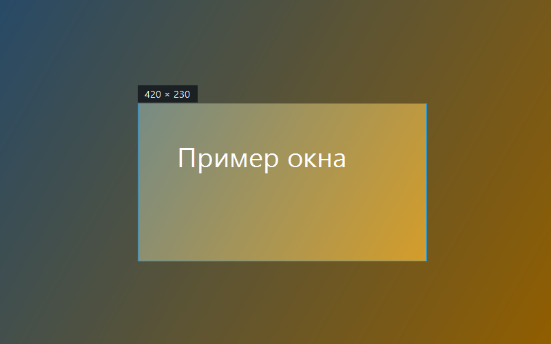

<div align="center">

# 📸 SnipShot

**Скриншот области по горячей клавише: сразу и в буфере обмена, и в папке**




</div>

## ✨ Возможности

- ✂️ `Ctrl+Alt+A`: выдели мышью любую область, рядом показывается её размер в пикселях
- 🖥️ `Ctrl+Alt+S`: весь экран (тот, где сейчас курсор). `Ctrl+Alt+W`: активное окно без тени
- 📋 Снимок сразу в буфере обмена, вставляй `Ctrl+V` в чат или документ
- 💾 И одновременно сохраняется PNG с датой в имени (по умолчанию `Изображения\SnipShot`)
- 🖱️ Esc или правый клик отменяют выделение. Во время выделения экран «замораживается», так что можно снять и всплывающие меню
- 🖥️🖥️ Работает с несколькими мониторами и высоким DPI. Живёт в трее

## 💡 Когда пригодится

- Быстро показать ошибку коллеге или в поддержку
- Сохранить кусок переписки, чек или расписание
- Делаешь инструкцию и нужно много однотипных скриншотов подряд

<div align="center"></div>

## 📥 Установка

1. Скачай `SnipShot.exe` из раздела [**Releases**](../../releases/latest)
2. Запусти его, установка не нужна

## 🛠️ Сборка из исходников

Нужен только Windows: компилятор C# входит в состав .NET Framework.

```bat
build.bat
```

## 📄 Лицензия

[MIT](LICENSE)
